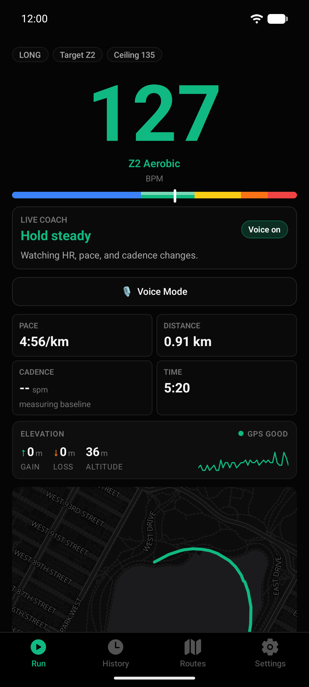
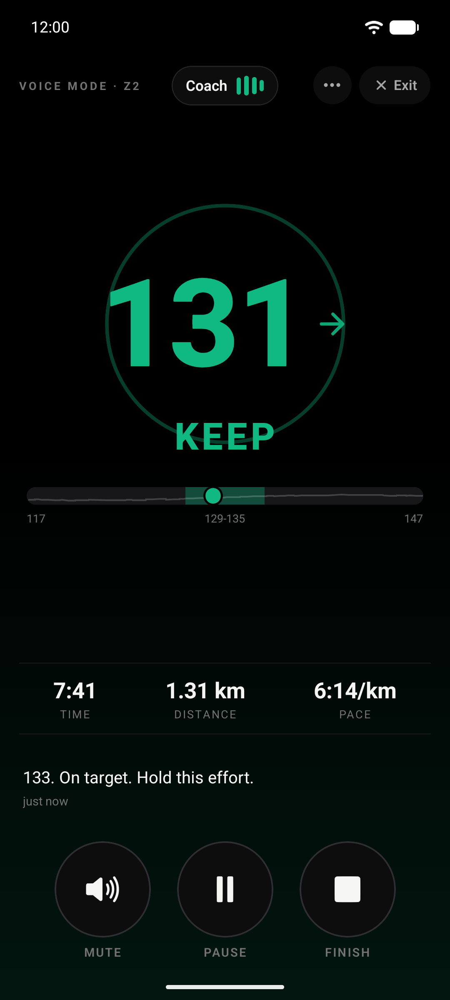
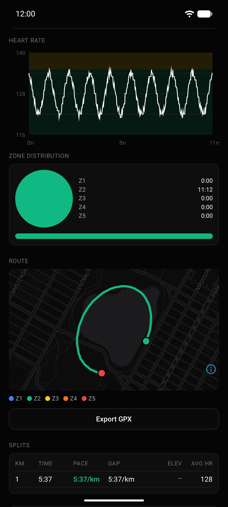
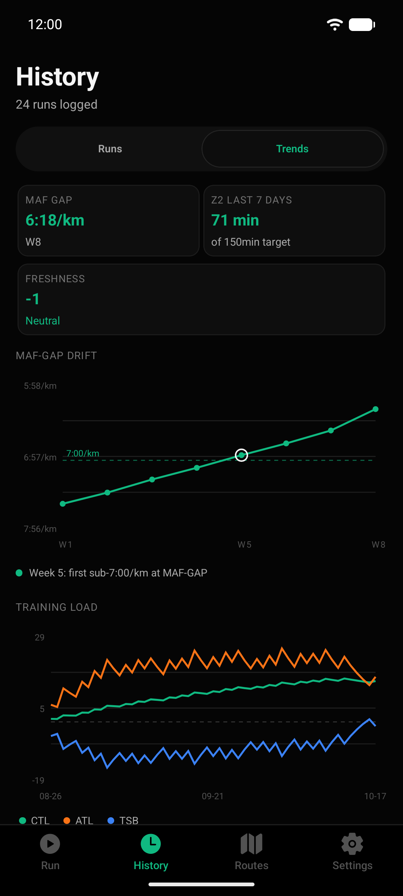
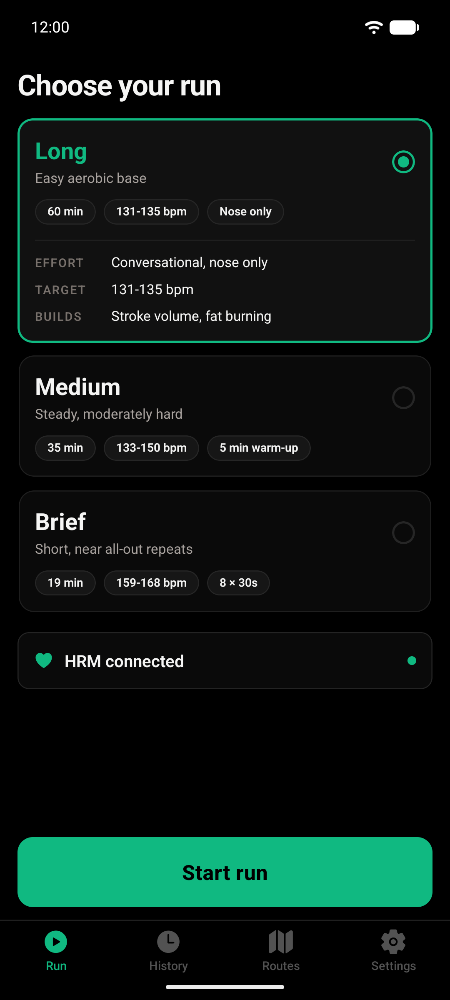

# BaseMile

**A free heart rate running coach for building your aerobic base. It runs entirely on your phone.**

BaseMile covers the cardio days of the Foundational Fitness week that Andrew
Huberman describes in his book *Protocols*: the Long, Medium and Brief runs.
Its sibling app, [PlateClimb](https://github.com/likwiid/plateclimb), covers
the lifting days.

BaseMile pairs with a Bluetooth chest strap, keeps you in the right heart rate
zone with a spoken coach, and turns your runs into clear trends: MAF pace,
aerobic decoupling, training load and more. It is fully local: no account, no
server, no sync, no AI. Your data stays on your phone. No subscription, no
ads, no tracking.

<p>
  
  
  
  
  
</p>

## Install

**Android:** download `BaseMile-<version>.apk` from the
[latest release](https://github.com/likwiid/basemile/releases/latest) and open
it on your phone. Allow installs from your browser when Android asks. It needs
Android 7.0 or newer.

An APK signed with the BaseMile release key is the official build. The
certificate SHA-256 fingerprint of that key is:

```
95:82:76:81:F9:2F:94:85:BD:93:01:CF:C3:B2:99:37:9C:D3:AD:FA:A0:F2:A4:9F:A2:C0:15:9A:DB:B6:8A:64
```

Check it with `apksigner verify --print-certs BaseMile-<version>.apk`.

**iPhone:** there is no App Store build. Build it from source with Xcode, see
[Quick start](#quick-start).

## Features

- **Three run types.** Long (continuous Zone 2 under your MAF ceiling), Medium
  (a warm-up, then a sustained block at a higher band) and Brief (a warm-up,
  then 30/60 repeats or a 4x4). Targets come from your own heart rate profile.
- **Live heart rate coaching.** Zones from your resting and max heart rate,
  MAF ceiling alerts, an escalating warning when you run well over the ceiling,
  cadence and fueling reminders.
- **A spoken coach that works offline.** Cues are spoken by your phone's own
  text-to-speech voice. **Voice Mode** is a hands-free screen that holds a
  strict heart rate band (KEEP, LIFT, EASE) and can add short sports
  psychology cues between heart rate calls.
- **Run tracking.** GPS distance, pace, splits and a route map; cadence from
  the phone's pedometer; weather at the start of the run.
- **Run detail.** Heart rate chart, zone distribution, splits, elevation
  profile corrected with terrain data, grade-adjusted pace, aerobic decoupling
  and notes on sleep, fuel, surface and niggles.
- **Trends.** MAF pace and MAF-GAP drift, weekly Zone 2 minutes, training load
  (CTL, ATL, TSB), VDOT, decoupling and HRV.
- **Routes.** Repeated routes are detected automatically, with a heat map of
  everywhere you run and per-route history.
- **Tests.** Resting heart rate, max heart rate, resting HRV and a breath-hold
  test.
- **Share a run.** Send any run as JSON or GPX through your phone's share
  sheet.

## Why it's free

I built BaseMile for my own training, and I think software like this should be
free. Your heart rate, your routes and your habits are some of the most
personal data you have. They should not sit behind a subscription or feed
someone's ad model. So the code is open, the app needs no account and no
server, and anyone can read it, change it and share it under the GPL.

If it helps you run better, that is the whole point.

Gabriel, [Likwiid](https://likwiid.com)

## Quick start

BaseMile uses native modules (Bluetooth, maps, a foreground service), so it
does not run in Expo Go. You build a development client once.

Requirements: Node 20 and npm, plus the Android SDK and a phone or emulator
(or Xcode for iOS).

```bash
git clone https://github.com/likwiid/basemile.git
cd basemile
npm ci
```

Check that everything is in order:

```bash
npm run typecheck
npm run lint
npm test
```

### Android (main platform)

Plug in a phone with USB debugging on, then:

```bash
npm run android   # generates the native project, builds and installs the dev client
npm start         # starts Metro for the dev client on later sessions
```

### iOS

```bash
npm run ios
```

The iOS project is configured (Bluetooth, background location and audio) but
gets far less testing than Android. Reports and fixes are welcome.

### No strap at hand

In a development build, turn on **Mock HR source** in Settings, Data &
developer to feed the app a simulated heart rate.

## Heart rate strap setup

BaseMile reads the standard **Bluetooth Heart Rate profile**, so any chest
strap or armband that broadcasts heart rate over Bluetooth Low Energy should
work. The **Garmin HRM-Dual** is the strap it is tested with.

**Not supported:** Apple Watch and other watches that do not broadcast heart
rate as a standard Bluetooth sensor, and ANT+ only devices.

1. Put the strap on and wet the electrodes so it wakes up.
2. In the app, open **Settings, Heart rate strap, Manage strap** (or tap
   **Connect strap** on the Run tab) and scan.
3. Pick your strap from the list. BaseMile remembers it and reconnects
   automatically next time.

Resting HRV needs a strap that sends RR intervals (the HRM-Dual does).

## Privacy

BaseMile is fully local. There is no account, no BaseMile server and no sync:
runs, heart rate, routes, profile and settings live only in the app's storage
on your phone. Android's cloud backup is switched off for the app, and there
is no export of the whole history, so uninstalling the app or resetting the
phone deletes them. The only network use is two public third-party services:

- **Open-Meteo** (`api.open-meteo.com`): when a run starts, its coordinates
  are sent to fetch the current weather; after a run, its GPS points are sent
  to look up terrain elevation. You can turn both off in **Settings, Data &
  developer, Weather and elevation**. Without them, runs keep GPS altitude
  and show no weather.
- **OpenFreeMap** (`tiles.openfreemap.org`): map tiles and label fonts load
  from OpenFreeMap's servers, so OpenFreeMap sees which map areas you view. You
  can point the app at another tile provider with `EXPO_PUBLIC_MAP_TILE_URL`.

The coach speaks with your phone's built-in text-to-speech engine; BaseMile
calls no voice service. Nothing else is sent anywhere. A run only leaves the
phone when you share it yourself as a JSON or GPX file.

### Map tiles

The map uses [OpenFreeMap](https://openfreemap.org)'s dark style, which needs
no key, no account and no setup. The style ships inside the app, so the map
background and your run track still show with no network.

To use another tile provider instead, copy `.env.example` to `.env.local` and
set `EXPO_PUBLIC_MAP_TILE_URL` (an https `{z}/{x}/{y}` raster template) and
`EXPO_PUBLIC_MAP_ATTRIBUTION`. Both are read at build time. These are the only
build variables BaseMile has.

## Architecture

BaseMile is an Expo SDK 55 / React Native app in strict TypeScript:
expo-router screens, Zustand stores, SQLite history, react-native-ble-plx for
the strap, MapLibre for maps and hand-written SVG charts. The coach engine and
the metrics are pure modules with unit tests.

```
app/          screens (Run, History, Routes, Settings, run and route detail)
components/   UI by feature
lib/          ble, coach, metrics, run, route, elevation, storage, export
types/        shared type contract
docs/adr/     architecture decision records
```

See [ARCHITECTURE.md](ARCHITECTURE.md) for the full map, the heart rate
pipeline and the data model, and [docs/coach-spec.md](docs/coach-spec.md) for
how the coach picks its cues.

## Roadmap

Ideas, not promises. Issues and pull requests are welcome.

- More testing and polish on iOS.
- Miles and other unit options (distances and paces are metric today).
- Optional training plans built on top of the three run types.
- Export to FIT or TCX, and to Health Connect and Apple Health.
- Translations.

## Contributing

Read [CONTRIBUTING.md](CONTRIBUTING.md) and the
[Code of Conduct](CODE_OF_CONDUCT.md). Security issues go to the address in
[SECURITY.md](SECURITY.md), not to public issues. Changes are listed in
[CHANGELOG.md](CHANGELOG.md).

## License

BaseMile is free software: you can redistribute it and modify it under the
terms of the GNU General Public License as published by the Free Software
Foundation, either version 3 of the License, or (at your option) any later
version (**GPL-3.0-or-later**). See [LICENSE](LICENSE) for the full text.
Each source file carries the SPDX identifier `GPL-3.0-or-later`.

Copyright (C) 2026 Gabriel Ghoussoub.

## Credits

BaseMile builds on published training methods and open data. Thank you to:

- **Andrew D. Huberman**, *Protocols: An Operating Manual for the Human Body*
  (Simon Element). The Long, Medium and Brief run types are adapted, in our
  own words, from the endurance guidance in this book.
- **Dr Phil Maffetone**, the MAF 180 Formula. "MAF" in the app refers to his
  method.
- **NTNU** (Norwegian University of Science and Technology), the 4x4 interval
  protocol (Helgerud and colleagues, 2007).
- **Brian Mackenzie**, the CO2 tolerance breath-hold test.
- **Jack Daniels**, VDOT; **Hirofumi Tanaka** and colleagues, the age-predicted
  max heart rate formula; **Martti Karvonen**, heart rate reserve zones;
  **Eric Banister**, TRIMP and the fitness and fatigue model behind CTL, ATL
  and TSB.
- **Peter Attia**, for popularising the weekly Zone 2 volume target.
- Endurance psychology research behind the coach cues: Alex Hutchinson,
  *Endure*; Samuele Marcora's psychobiological model of endurance; Blanchfield
  and colleagues (2014) on motivational self-talk; Brick and colleagues (2018)
  on smiling and running economy; Kross and colleagues (2014) on distanced
  self-talk. Full notes in [docs/coach-spec.md](docs/coach-spec.md).
- **[Open-Meteo](https://open-meteo.com/)** for weather and elevation data,
  licensed under [CC BY 4.0](https://creativecommons.org/licenses/by/4.0/).
- Map data **© [OpenStreetMap](https://www.openstreetmap.org/copyright)
  contributors**, map tiles by **[OpenFreeMap](https://openfreemap.org)** with
  the **© [OpenMapTiles](https://www.openmaptiles.org/)** schema. Forks are
  responsible for the terms of whatever tile provider they use.
- The open source projects BaseMile is built with, including Expo, React
  Native, MapLibre, react-native-ble-plx and Zustand.

## Disclaimers

BaseMile is an independent project and is not affiliated with or endorsed by
Andrew Huberman or Huberman Lab. Nor is it affiliated with or endorsed by any
other person, organisation or service credited above.

**Not medical advice.** BaseMile gives heart rate targets and training
feedback for general fitness only. Talk to a doctor before starting a new
training programme, especially if you have a heart condition or take
medication that affects heart rate. Stop exercising and seek help if you feel
chest pain, dizziness or unusual breathlessness. Readings from straps and
phone sensors can be wrong.

## Built by Likwiid

BaseMile is built and maintained by [Likwiid](https://likwiid.com).
